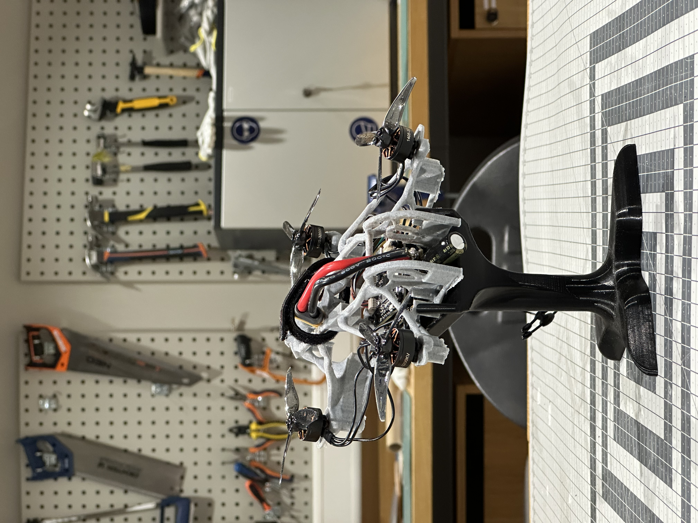

# 🇪🇺 Homemade Drone, Built With as Many European Parts as Possible

A fully homemade FPV quadcopter with a **3D-printed frame** and an electronics stack **designed in France**. The aim of this project is to see how far you can get building a drone from European hardware, and to be honest about which parts still come from elsewhere.

  
   
  <em>The drone on its 3D-printed display stand</em>

## 🎬 Video

  
   
  <em>▶️ Build showcase, click to watch on YouTube</em>

---

## 🧩 Bill of materials

| Part | Component | Origin | Link |
|---|---|---|---|
| **Frame** | Custom 3D-printed frame, adapted from an existing model | 🇧🇪 Printed at home in Belgium | [`/frame`](frame/) |
| **Flight controller** | Drone Français **Abell** | 🇫🇷 Designed in France | [Product page](https://dronefrancais.fr/en/produit/carte-de-vol/) |
| **ESC** | Drone Français **Centurion V2**, 4-in-1, 65 A | 🇫🇷 Sold by a French company | [Product page](https://dronefrancais.fr/en/produit/esc-centurionv2-4en1-3-a-6s-65a/) |
| **Receiver** | RadioMaster **RP3** (ExpressLRS 2.4 GHz) | 🌏 Non-EU | — |
| **Motors** | 4× **1405 3200KV** brushless | _TBD_ | _Link to be added_ |

>
> **Why the receiver isn't European:** I haven't found an EU-made equivalent yet. If you know of any, please open an issue!

---

## ⚙️ Electronics in detail

### Flight controller: Abell (Drone Français)

Drone Français describes the Abell as the first flight controller designed in France, built with as many French and European electronic components as possible.

| Spec | Value |
|---|---|
| MCU | STM32H743VIT6 |
| IMU | Dual ICM-42688-P |
| Input voltage | 3–6S |
| Mounting | 30.5 × 30.5 mm |
| Weight | ~2 g |
| UARTs | 7 |
| Outputs | 8× DShot / 8× PWM |
| OSD | Analog |
| Logging | microSD (blackbox) |
| USB | Type-C |
| Firmware | Betaflight, INAV, ArduPilot |

### ESC: Centurion V2 4-in-1 (Drone Français)

| Spec | Value |
|---|---|
| Input voltage | 3–6S |
| Continuous current | 65 A per motor (75 A peak) |
| Firmware | BLHeli_S |
| Mounting | 30.5 × 30.5 mm, M3 |
| Dimensions | 50 × 44 mm |
| Weight | ~12 g |

### Radio link: ExpressLRS

The receiver is a standard **RadioMaster RP3** running **ExpressLRS (ELRS) 2.4 GHz**, wired to one of the FC's UARTs over CRSF.

---

## 🖨️ Frame

The frame is **3D printed** from a custom model that I adapted from an existing design. Its organic, lattice-like structure keeps it light while holding the stack, the motor mounts and a battery strap on top.

The display stand in the photo is also 3D printed.

- **Material:** PLA / PLA+

---

## 🔧 Firmware & configuration

| Item | Version / Notes |
|---|---|
| Flight firmware | Betaflight |
| ESC firmware | BLHeli_S |

Firmware for the Abell is available on the [Drone Français stack page](https://dronefrancais.fr/en/produit/stack-dronefrancais/).

---

## 🤝 Contributing

Know of a European FPV part? Spotted a mistake? Issues and pull requests are welcome.
